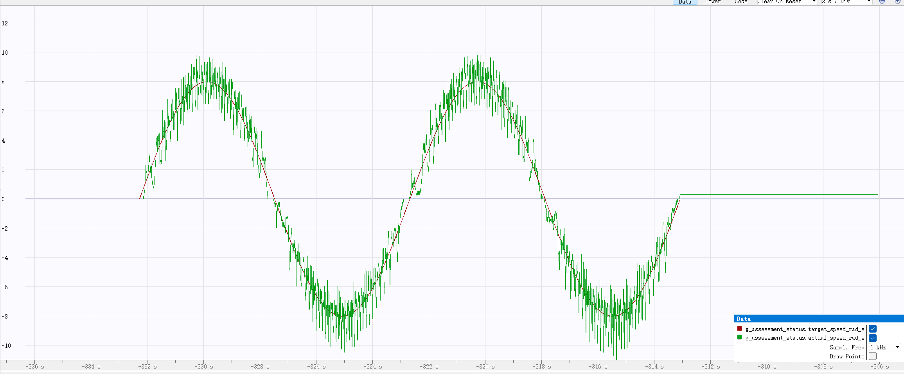

# GM6020 正弦速度与位置控制

基于 STM32F407 开发板 C 型，以 1 kHz 运行位置 P 外环与速度 PI 内环，支持 KEY 启停、CAN 反馈、看门狗及故障停止。

## 当前参数

CAN1：1 Mbps，GM6020 ID 1，电流控制。参数见 [ControlConfig.h](C_board_src/ControlConfig.h)。

| 项目 | 参数 |
| --- | --- |
| 速度内环 | P220、I100、D0 |
| 位置外环 | P7 |
| 速度轨迹 | 幅值 8 rad/s，周期 8 秒 |
| 位置轨迹 | 以启动角度为中心，幅值 1 rad，周期 8 秒 |
| 每次运行 | 两个周期，共 16 秒 |
| 电流给定限幅 | ±2500 raw |

## 构建与运行

需要 ARM GNU 工具链、CMake 和 Ninja。构建对应项目后，用 Ozone 与 J-Link 打开入口：

| 构建预设 | Ozone 工程 | KEY 行为 |
| --- | --- | --- |
| `SpeedDebug` | [速度曲线](ozone/GM6020_speed.jdebug) | 每次短按运行速度测试，mode=4 |
| `PositionDebug` | [位置曲线](ozone/GM6020_position.jdebug) | 每次短按运行位置测试，mode=5 |

```sh
cmake --preset SpeedDebug
cmake --build --preset SpeedDebug
# 测位置时将 SpeedDebug 换成 PositionDebug
```

Ozone 下载运行后，短按并释放 KEY 启动；运行中按 KEY 停止，长按约 1 秒停止并尝试清故障。曲线与 1 kHz 采样已预置，在 Timeline 的 Data 区域查看，时间刻度可选 2 s/Div。

`rms_error`、`max_abs_error` 为本次误差；速度单位 rad/s，位置单位 rad。`output_fault`、`can_tx_errors` 用于查看故障与发送错误。上电默认停止，结束后输出归零。

`Debug` 预设保留速度、位置依次运行的入口。GitHub Actions 的 `gm6020-firmware` 产物包含已构建的工程文件与 ELF，解压到仓库根目录即可使用。

## 曲线与测试

当前速度实测曲线（8 rad/s，P220 / I100 / D0）：



[当前记录](docs/results/current.json) · [v1.0.0 历史实测](docs/results/measurements.json)

```sh
python tests/run_tests.py
```

测试覆盖 CAN 编解码、控制限幅、模式选择、KEY/串口启停、反馈超时、故障停止及看门狗喂狗条件。
