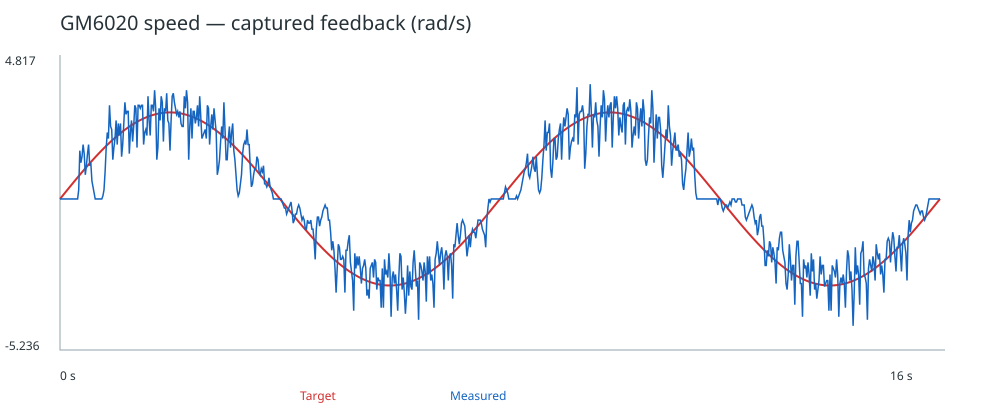
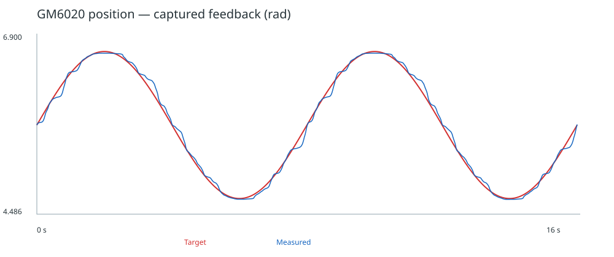

# GM6020 正弦速度与位置控制

最终提交版 **v1.0.0**。基于 STM32F407 开发板 C 型，以1 kHz运行位置P外环和速度PID内环，实现正弦速度、位置跟踪，支持KEY启停、看门狗及故障停止。

采用近期实测中兼顾速度削峰与位置跟随的组合，D项滤波恢复为10 ms，参数在本版冻结。源码见本仓库，源码压缩包与校验文件见 [v1.0.0发布页](https://github.com/Fqin9/gm6020-sine-control/releases/tag/v1.0.0)。

## 硬件与最终参数

默认使用CAN1（1 Mbps）、GM6020 ID 1、电流控制协议。参数集中在 [ControlConfig.h](C_board_src/ControlConfig.h)。

| 参数 | 最终值 |
| --- | --- |
| 速度PID | Kp=210，Ki=120，Kd=0.8 |
| D项滤波时间 / 独立限幅 | 10 ms / ±150 raw |
| 速度反馈滤波系数 | 0.5 |
| 位置外环Kp | 7 |
| 摩擦前馈 | 340 raw |
| 起动补偿 | 连续低速等待100 ms，增长1 raw/ms，上限200 raw |
| 总电流给定限幅 | ±2500 raw |

角度相关前馈为当前电机的经验值，更换电机可通过配置中的开关关闭并重新标定。

## 运行方法

烧录后运行程序，上电默认停止。正常供电、反馈在线且故障为零后：

1. 短按并释放KEY：速度正弦，幅值3 rad/s、周期8秒，16秒后自动停止。
2. 再短按KEY：位置正弦，以启动位置为中心、幅值1 rad、周期8秒，16秒后自动停止。
3. 运行中按KEY立即停止；长按约1秒停止并尝试清故障，恢复后不会自动启动。

在Cortex Live Watch查看 `g_assessment_status`：模式4为速度、5为位置，`rms_error`、`max_abs_error`为本次累计误差，`completed`只表示轨迹按时结束。故障与发送错误查看 `g_control_status.output_fault`、`g_control_status.can_tx_errors`。结束后输出归零，不持续位置保持；下一次启动会覆盖板端曲线日志。

## 实测结果

2026-10-17，本机空载，两项记录各16秒。速度记录采用相同内环参数；位置记录采用外环P7。数据与参数说明见 [measurements.json](docs/results/measurements.json)。

| 项目及统计口径 | RMS误差 | 最大绝对误差 |
| --- | --- | --- |
| 速度，1 kHz累计、16000样本 | 0.604831 rad/s | 1.899222 rad/s |
| 位置，20 ms抽样、801点 | 0.051364 rad（2.94°） | 0.159894 rad（9.16°） |

速度20 ms抽样绝对峰值为4.398230 rad/s；速度曲线仍存在纹波。位置这一轮没有保留1 kHz误差统计，不能将抽样最大误差当作完整速率最大值。各轮起始角度不同，单次结果不保证所有工况下相同。

历史无D版本（提交 `94abfb1`）位置RMS约2.15°，比本版记录更小；本次冻结近期兼顾速度削峰与位置跟随的组合，不声称所有指标均最优。任务没有提供数值误差门槛，最终版标记不代表精度验收结论。





## 构建与测试

需要ARM GNU工具链、CMake和Ninja；主机控制逻辑测试另需Python 3和g++。

```sh
cmake --preset Debug
cmake --build --preset Debug
python tests/run_tests.py
```

调试固件产物为 `build/Debug/C_project.elf`，可通过DAPLink/OpenOCD烧录，并保留Live Watch所需调试信息。发布页提供源码压缩包及SHA256校验文件。

测试覆盖CAN收发编码、限幅、启停、超时与故障停止、轨迹记录、看门狗喂狗条件及输入命令。看门狗仅在前台循环和控制任务持续推进时喂狗；尚未进行硬件故障注入复位测试。

## 主要代码

- [AssessmentController.cpp](C_board_src/AssessmentController.cpp)：正弦轨迹、位置P、速度PID及前馈。
- [ControlTask.cpp](C_board_src/ControlTask.cpp)：CAN、调度、启停、保护和曲线记录。
- [KeyControl.cpp](C_board_src/KeyControl.cpp)：KEY入口。
- [export_assessment.py](tools/export_assessment.py)：将RAM日志转换为CSV、SVG和误差统计。
